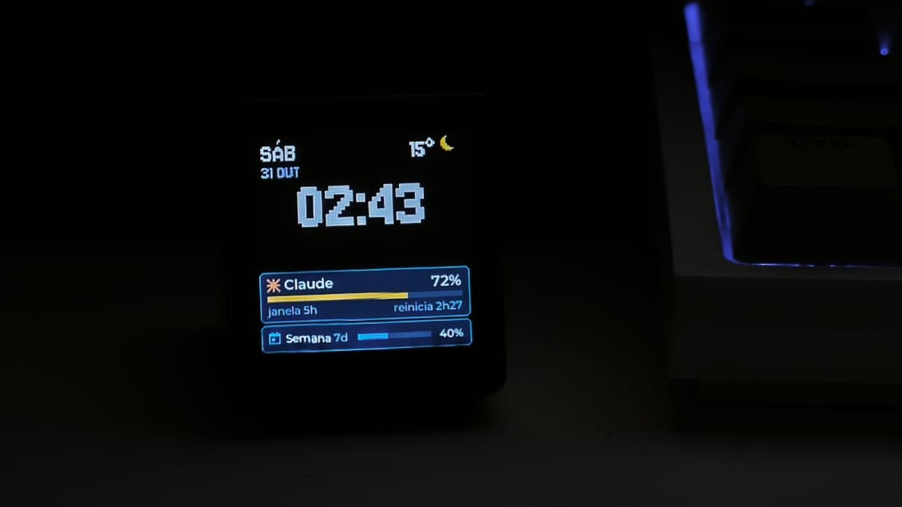
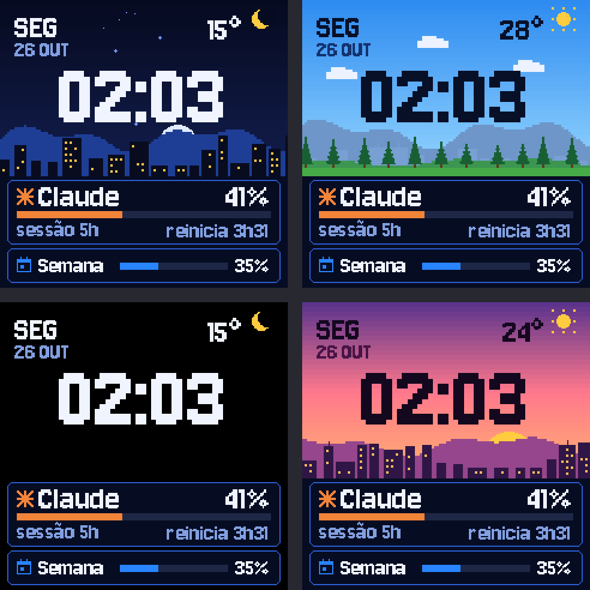
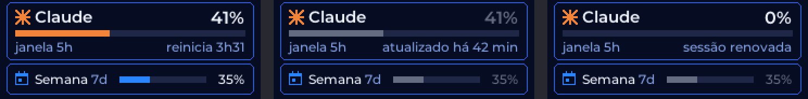
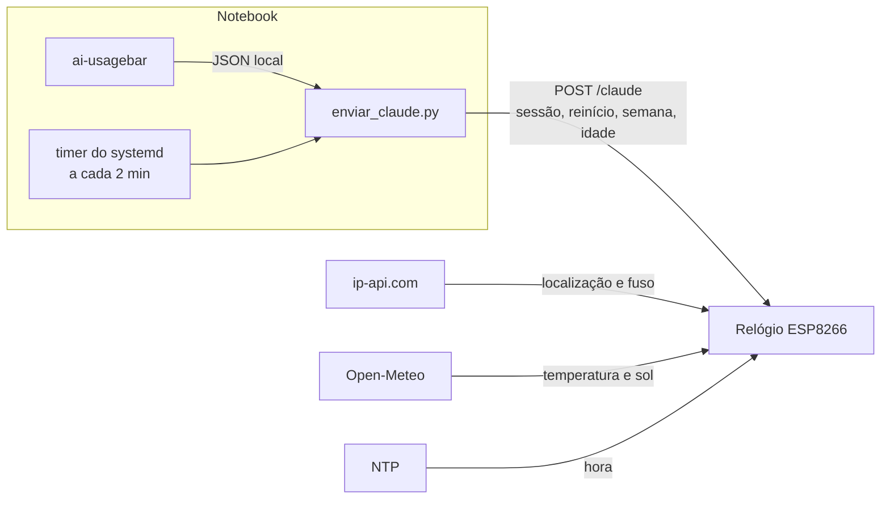

# RERelogio

Um relógio de mesa com ESP8266 que ganhou firmware novo. Ele mostra a hora, o clima de
onde ele está e quanto ainda resta do meu limite do Claude, em pixel-art que acompanha o céu
de verdade.



<sub>Na mesa, às 02:43, no tema minimalista (modo quarto, brilho reduzido). A barra do
Claude está em âmbar porque a sessão passou de 60%.</sub>



<sub>Prévia gerada pelo mesmo código que desenha no aparelho, pixel a pixel. Noite e dia
em cima; minimalista (modo quarto) e pôr do sol embaixo.</sub>

## O que ele faz

- **Hora e clima, onde quer que esteja.** O relógio descobre a própria localização e o
  fuso horário pelo IP ([ip-api.com](https://ip-api.com)) e busca temperatura, ícone e
  horários do sol no [Open-Meteo](https://open-meteo.com). Nenhuma chave de API, nenhuma
  cidade no código.
- **Limite do Claude.** A janela de 5 horas aparece em destaque, com contagem até
  reiniciar, e a semanal logo abaixo. A barra muda de cor aos 60% e aos 85%.
- **Tema que segue o sol.** Dia, pôr do sol e noite trocam pelo nascer e pôr do sol
  reais de cada dia. Das 23h às 7h entra o tema minimalista, com o brilho em ~15%,
  porque o relógio fica no quarto.
- **Não finge que sabe.** Se o notebook passa 15 minutos sem enviar dados, os números
  ficam cinza com "atualizado há X". Se a janela de 5h já reiniciou, mostra
  "sessão renovada" em vez de um percentual que não vale mais.
- **Sem cabo.** Firmware e imagens são atualizados pelo Wi-Fi (OTA). O USB só alimenta.



## Como funciona



O login do Claude nunca sai do notebook: o relógio recebe só quatro números e a idade
deles. Quem lê o uso é o [ai-usagebar](https://github.com/akitaonrails/ai-usagebar), que
já roda na minha barra de status.

## Destaques técnicos

**Engenharia reversa antes de apagar qualquer coisa.** Antes de gravar o primeiro byte,
copiei os 4 MB da memória duas vezes e comparei setor a setor: 1021 de 1024 setores
idênticos. Os 3 que mudavam eram a área onde o SDK regrava a configuração do Wi-Fi a
cada boot, ou seja, a cópia era confiável. A restauração do firmware de fábrica foi
testada no aparelho antes de seguir. Os pinos da tela vieram de relatos da comunidade e
foram confirmados com um firmware de teste. Nesse teste também apareceu que a luz de
fundo é invertida: sinal baixo acende.

**Tela inteira com 7,5 KB de RAM.** Uma imagem de 240×240 em RGB565 ocupa 115 KB, e o
ESP8266 tem cerca de 40 KB livres. A tela é composta em 15 faixas de 16 linhas: cada
faixa lê o fundo do tema no sistema de arquivos, recebe o texto e os ícones por cima e
vai para o display. Nada pisca, porque nenhum pixel é apagado antes de ser redesenhado.

**A prévia é o firmware.** `design/tela.py` desenha a tela no PC. `design/gerar.py`
transforma as fontes em tabelas de glifos (Jersey 10 em 1 bit para o visual pixel,
Montserrat suavizada em 4 bits para os cartões) e os cenários em fundos RGB565. O
firmware desenha com as mesmas tabelas e o mesmo algoritmo. O visual inteiro foi
ajustado olhando a prévia, sem gravar o relógio a cada tentativa.

**Cenários gerados por código.** Cidade, janelas acesas, morros, pinheiros e estrelas
são procedurais, com semente fixa: o mesmo céu em toda geração.

## Hardware

| | |
|---|---|
| Placa | "Smart Weather Clock" da GeekMagic (linha SmallTV), ESP8266EX com 4 MB de flash |
| Tela | ST7789, 240×240, SPI modo 3, sem CS |
| Pinos | MOSI 13 · SCLK 14 · DC 0 · RST 2 · luz de fundo 5 (PWM invertido) |
| Memória | firmware em ~400 KB; 4 fundos de 112,5 KB no LittleFS (partição de 2 MB) |

## Estrutura

```
design/      prévia, temas, fontes e o gerador de recursos do firmware
firmware/    projeto PlatformIO (Arduino) do relógio
scripts/     envio do limite do Claude, timer do systemd, utilitários de flash
docs/        diário do projeto: decisões, evidências e próximos passos
```

## Rodando o seu

Precisa de [uv](https://docs.astral.sh/uv/) (o PlatformIO e o esptool rodam via `uvx`),
Python 3 com Pillow e, para o limite do Claude, o ai-usagebar.

1. **Guarde o firmware de fábrica.** Não pule esta etapa:
   ```bash
   uvx esptool -p /dev/ttyUSB0 -b 460800 read-flash 0 0x400000 backup/fabrica-4MB.bin
   ```
2. **Credenciais do Wi-Fi** em `firmware/include/segredos.h`, arquivo fora do git:
   ```cpp
   #pragma once
   #define WIFI_NOME  "sua-rede"
   #define WIFI_SENHA "sua-senha"
   ```
3. **Localização (opcional).** Por padrão vem do IP, com precisão de bairro ou cidade
   vizinha. Para fixar um ponto exato, acrescente ao `segredos.h`:
   ```cpp
   #define LATITUDE  -12.34
   #define LONGITUDE -56.78
   ```
4. **Gere os recursos e grave.** Na primeira vez, pelo USB; depois, `-e ota` pelo Wi-Fi:
   ```bash
   python3 -I design/gerar.py
   cd firmware
   uvx platformio run -t uploadfs   # fundos dos temas
   uvx platformio run -t upload     # firmware
   ```
5. **Envio do limite do Claude,** no notebook:
   ```bash
   cp scripts/systemd/rerelogio-claude.* ~/.config/systemd/user/
   systemctl --user enable --now rerelogio-claude.timer
   ```

Para voltar ao firmware de fábrica:
`uvx esptool -p /dev/ttyUSB0 -b 460800 write-flash 0 backup/fabrica-4MB.bin`.

Para testar os temas sem esperar o horário: `http://<ip-do-relogio>/tema?n=0` (noite),
`1` (dia), `2` (pôr do sol), `3` (minimalista) e `-1` (automático).

## Créditos

- [ai-usagebar](https://github.com/akitaonrails/ai-usagebar), de Fabio Akita, licença MIT.
- Fontes [Jersey 10](https://fonts.google.com/specimen/Jersey+10) e
  [Montserrat](https://github.com/JulietaUla/Montserrat), licença SIL OFL 1.1. As
  licenças estão em `design/fontes/`.
- Pinagem da tela: comunidade do
  [Home Assistant](https://community.home-assistant.io/t/installing-esphome-on-geekmagic-smart-weather-clock-smalltv-pro/618029).
- Clima: [Open-Meteo](https://open-meteo.com). Localização: [ip-api.com](https://ip-api.com).

## Licença

O código está sob a licença [MIT](LICENSE): use, modifique e redistribua à vontade,
mantendo o aviso de copyright. As fontes em `design/fontes/` seguem a própria licença
(SIL OFL 1.1).

---

Feito por [Vinicius de Oliveira Coutinho](https://github.com/ViniOC).
